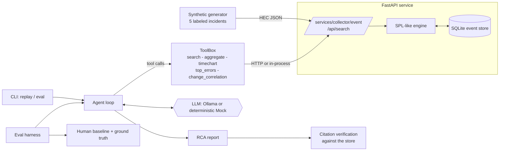

# SplunkPilot: Agentic Incident Triage over Machine Data

An AI agent that investigates a simulated outage by querying Splunk-style logs, correlating events,
and writing a root-cause report with evidence.

SplunkPilot ships a Splunk HEC-compatible ingest endpoint, an SPL-like search language over a local
SQLite event store, a synthetic generator with five labeled incident scenarios, a tool-calling
investigator agent (local LLM via Ollama, or a deterministic mock for offline runs), and an
evaluation harness that scores it against a human-written baseline.

## Results

Reproduce with `splunkpilot eval --seeds 5` (offline, mock LLM, 25 runs, ~3 s total). The agent never sees
the scenario label; it only gets the alert and the machine data.

| Scenario | Runs | Root cause correct | Service correct | Evidence precision | Agent time (s) | Tool calls | Human baseline (min, estimate) |
|---|---|---|---|---|---|---|---|
| bad_deploy  | 5 | 5/5 | 5/5 | 1.00 | 0.11 | 4 | 18 |
| memory_leak | 5 | 5/5 | 5/5 | 1.00 | 0.11 | 4 | 32 |
| dns_failure | 5 | 5/5 | 5/5 | 1.00 | 0.13 | 4 | 24 |
| auth_storm  | 5 | 5/5 | 5/5 | 0.97 | 0.25 | 5 | 21 |
| disk_full   | 5 | 5/5 | 5/5 | 1.00 | 0.13 | 5 | 27 |
| **Overall** | **25** | **25/25** | **25/25** | **0.99** | **0.15** | **4.4** | **24.4** |

Caveats: the mock LLM is a rule-based analyst I tuned on these scenarios, so this benchmark validates the
tools, pipeline and scorer rather than LLM generalization. Human times are authored estimates, not
measurements. Run `splunkpilot eval --llm ollama` to get real LLM accuracy and latency on your hardware.

## Features

- **Synthetic incidents**: one hour of realistic multi-service logs and metrics with one of five labeled
  incidents injected: `bad_deploy`, `memory_leak`, `dns_failure`, `auth_storm`, `disk_full`. Each has noise,
  red-herring deploys and downstream "victim" errors, so the symptom service is rarely the culprit.
- **HEC-compatible ingest**: `POST /services/collector/event` (and `/services/collector`) with
  `Authorization: Splunk <token>`, concatenated-JSON bodies and Splunk's response codes.
- **SPL-like search API**: `POST /api/search` and a Splunk-style `POST /services/search/jobs/export`.
  Supports `field=value` / wildcards / phrases / `AND OR NOT ()`, `earliest=`/`latest=`, and
  `where stats timechart top sort head tail table fields dedup rename`.
- **Agent with tools**: `search`, `aggregate`, `timechart`, `top_errors`, `change_correlation`.
  It outputs a structured RCA (root cause, confidence, impact, timeline, remediation, cited events).
  Citations are **verified against the store**: invented event ids are dropped and event text is
  always filled in from the database, never from the LLM.
- **Evaluation harness**: root-cause accuracy, service/host accuracy, evidence precision, tool calls and
  time-to-diagnosis versus a human baseline. It runs offline with the mock LLM and optionally with Ollama.
- **One-command demo**: `docker compose up` replays an incident and prints the RCA.

## Architecture



```
splunkpilot/
  api.py        FastAPI app (HEC + search)       spl.py        SPL parser/executor
  hec.py        HEC payload parsing              store.py      SQLite event store
  generator.py  scenarios + ground truth         backend.py    HTTP / in-process backends
  evaluation.py scoring + human baseline         cli.py        serve / replay / eval / ...
  agent/        agent loop, tools, llm, report schema
  data/human_baseline.json
tests/          pytest suite (SPL, API, generator, agent, eval, CLI)
```

### Sample session

`splunkpilot replay disk_full` prints an alert, the investigation and a cited RCA, for example:

```
ALERT 2026-01-15T10:42:13Z: checkout-api error rate above 10% (service: checkout-api)
Root cause : disk_full  service=db  host=db-01  (confidence 90%)
Evidence:  [#6512] db-01/db: PANIC: could not write to file pg_wal/...: No space left on device
           [#1]    db-01/db: logrotate job failed exit=1: cannot rotate /var/lib/postgresql/log
Investigation: 5 tool calls (top_errors, timechart, change_correlation, search, search) in 0.13s
```

To record a terminal GIF for your own write-up, use e.g. [`vhs`](https://github.com/charmbracelet/vhs) or
`asciinema` + `agg` around `splunkpilot replay disk_full`; no recording is bundled in this repo.

## Setup

Python 3.10+.

```bash
python -m venv .venv && source .venv/bin/activate
pip install -e ".[dev]"
cp .env.example .env     # optional; every setting has a local default
```

## Run

```bash
# Replay one incident fully in-process (no server needed) and print the RCA
splunkpilot replay bad_deploy          # also: memory_leak dns_failure auth_storm disk_full

# Or run the real stack: API in one terminal...
splunkpilot serve --port 8000
# ...and replay through HEC + the search API in another
SPLUNKPILOT_URL=http://localhost:8000 splunkpilot replay disk_full --remote

# Evaluation (offline, mock LLM)
splunkpilot eval --seeds 5 --json eval.json
```

### Docker Compose

```bash
docker compose up --build --abort-on-container-exit demo      # SCENARIO=disk_full docker compose up ... to pick one
```

This starts the API, then the `demo` container generates an incident, ingests it over HEC, lets the agent
investigate through the search API, and prints the RCA. (I could not run Docker in the authoring
sandbox, so the compose file was validated with `docker compose config` but not executed end to end; the
same flow is covered by the `--remote` run against a live `splunkpilot serve` and by the tests.)

### Using a local LLM (Ollama)

```bash
ollama pull llama3.1:8b          # any tool-calling model
SPLUNKPILOT_LLM=ollama splunkpilot replay memory_leak
splunkpilot eval --llm ollama --seeds 1
```

In Compose: `SPLUNKPILOT_LLM=ollama docker compose --profile ollama up --build demo` (or point `OLLAMA_URL`
at a host Ollama). If Ollama is unreachable the CLI exits with a clear error. Ollama results depend on the
model; I have only exercised the Ollama client against a mocked transport, not a live model.

### Ingest your own data

```bash
curl -s localhost:8000/services/collector/event -H 'Authorization: Splunk dev-hec-token' \
  -d '{"time":1768471200,"host":"web-01","index":"demo","event":{"service":"web","level":"ERROR","message":"boom"}}'
curl -s localhost:8000/api/search -H 'content-type: application/json' \
  -d '{"query":"level=ERROR | stats count by service","index":"demo","earliest":"2026-01-15T00:00:00Z"}'
```

## Test

```bash
pytest
```

58 tests cover the SPL engine, HEC/API behaviour and error codes, generator determinism and labeling, tools,
the agent loop (citation verification, repair, tool budget, Ollama transport), the scorer and the CLI,
including a full HEC → search → agent run through the FastAPI app.

## Evaluation

Scoring per run: `0.5 × root-cause category + 0.2 × service + 0.1 × host + 0.2 × evidence precision`
(fraction of cited events whose text matches the scenario's labeled evidence patterns). Time-to-diagnosis is
the agent's wall-clock time and tool-call count compared with the human baseline in
`splunkpilot/data/human_baseline.json`.

Mock-LLM result (`splunkpilot eval --seeds 3`, 15 runs; these numbers are from this repo's generator):

| metric | agent (mock) | human baseline |
|---|---|---|
| root-cause accuracy | 100% | 100% (by construction) |
| evidence precision | ~0.99 | 1.0 |
| tool calls | ~4–5 | n/a |
| time to diagnosis | < 1 s | 18–32 min (authored estimate) |

Read this honestly: the mock is a rule-based analyst (error-signature rules plus change correlation) that
I tuned against these five scenarios, so 100% shows the tools expose enough signal, the pipeline works, and
the scorer works. It does **not** show that an LLM generalizes. The "human" times are my authored estimates,
not measurements, and the sub-second agent times with the mock say nothing about LLM latency. Use
`--llm ollama` for meaningful time-to-diagnosis numbers.

## Key design decisions

- **SQLite over DuckDB**: stdlib, zero install, enough for ~10⁵ events. The SPL engine does time/equality
  pushdown into SQL and evaluates the rest in Python, so the store is swappable.
- **Own SPL subset**: a small, tested parser instead of an SPL clone; semantics follow Splunk where cheap
  (case-insensitive matching, newest-first default order, zero-filled `timechart`, rows lacking a `by` field dropped).
- **Ground truth never enters the store**: labels live in `GroundTruth`; the agent can only use machine data.
  Tools are scoped to the alert's `index`, so replays do not contaminate each other.
- **Mock LLM implements the same interface as Ollama** (chat messages with `tool_calls`), so the agent loop,
  tools and citation checks are tested identically in both modes.
- **Verified citations**: the agent never trusts model-written evidence text; confidence is capped at 0.3 if no
  citation survives verification.
- **Tool design for small models**: `top_errors` groups log templates (numbers/IPs collapsed) with services,
  hosts and sample ids, and `change_correlation` compares per-service error rates before/after each change, which
  gives a model the key facts in one call.
- **Robustness**: tool errors are returned to the model as data; invalid report JSON gets two repair
  attempts; the tool budget is enforced (default 10 calls) then a final answer is demanded.
- **Security defaults**: the HEC token defaults to a demo value (`dev-hec-token`) and is configured through the
  environment; the search API is unauthenticated, as it is intended for local use only.

## Adapting to a customer's environment

What carries over unchanged: the agent loop, report schema, citation verification and eval harness. What
changes is the data access layer and the labels.

1. **Data source**: implement the small `Backend` protocol (`search`, `get_event`, `ingest`) against the
   customer's platform. For real Splunk, `search` maps to the REST `search/jobs/export` endpoint (the SPL the
   tools emit is a subset of real SPL; `top_errors` and `change_correlation` would be re-expressed as `stats`/`rex`
   queries), authenticated with a scoped, read-only token supplied via environment variables.
2. **Field mapping**: map their sourcetypes and fields onto `service`, `host`, `level`, `message` and
   `sourcetype=change` (CI/CD, ServiceNow or config-management feeds are the change-correlation source).
3. **Signatures and taxonomy**: replace the five categories and the error-signature table with the customer's
   incident classes; seed them from past post-mortems. Real LLM mode needs no signature table, only the prompt.
4. **Benchmark on their history**: label 20-50 past incidents with root cause and evidence patterns, replay
   them through the harness, and replace the authored baseline minutes with measured MTTD/MTTR from their
   incident tracker. Gate rollout on accuracy and citation precision.
5. **Safety and governance**: tools are read-only and index-scoped; keep it that way. Run the LLM locally
   (Ollama) when logs cannot leave the network, add authentication to the search API, redact PII before
   indexing, keep a human approving any remediation, and log every tool call for audit (the `Investigation`
   trace already records them).
6. **Scale**: swap SQLite for the customer's index or DuckDB/ClickHouse; the SPL engine's pushdown hook is
   where time and field filters would go.

## Limitations

- Timestamps are fixed at 2026-01-15 per scenario; the generator does not stream in real time.
- The SPL subset has no `eval`, `rex`, joins or subsearches.
- One incident per run; no multi-incident disentangling.
